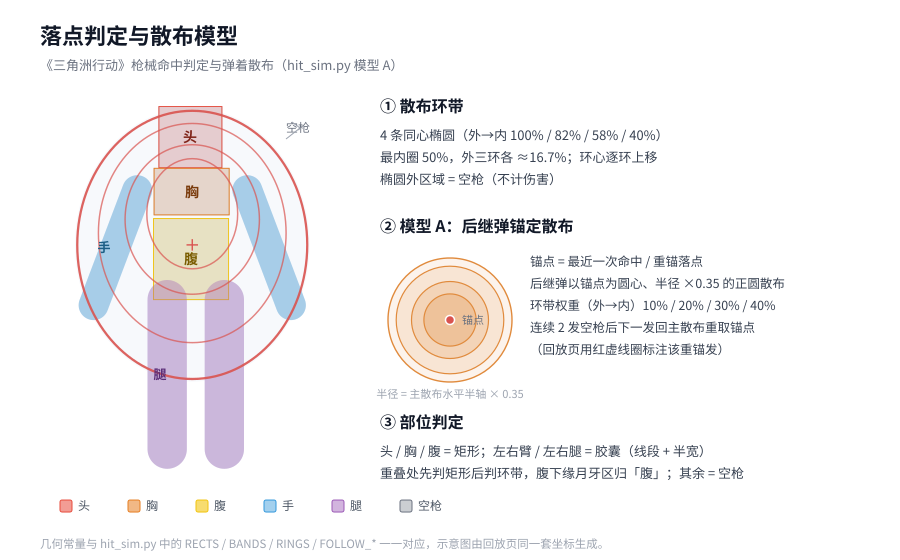

# 三角洲行动 · 伤害模型与 TTK/BTK 概率长表

用可编辑的 CSV 数据表 + 两段 Python 代码，复现《三角洲行动》(Delta Force) 烽火地带的枪械伤害结算、破甲机制、弹着散布与击杀枪数（BTK）/击杀时间（TTK）分布，并批量产出全枪械概率长表。

本项目是个人数值策划学习与作品集材料：公式与参数来自游戏内实测与社区 wiki 整理，代码把"纸面公式"换算成可横向比较的枪械强度。

## 仓库结构

```
.
├── README.md
├── LICENSE
├── .gitignore
└── delta-force-damage-model/
    ├── damage_calc.py          # 伤害公式与确定性击杀模拟，含特殊/连发射速曲线
    ├── hit_sim.py              # 弹着散布 + 部位判定 + 蒙特卡洛 BTK/TTK，批量输出概率长表
    ├── guns.csv                # 89 行枪械（含 21 行改枪变体）：基伤/甲伤/射速/部位倍率/距离衰减
    ├── ammo1.csv               # 69 发弹药：穿透等级/基伤比例/甲伤系数/各部位倍率/对 1–6 级甲甲伤倍率
    ├── armor.csv               # 45 件护甲（身甲与头盔分列，含耐久与是否防护腹部/肩部）
    ├── hitbox-model.svg        # 落点判定与散布模型示意图
    └── ttk_btk_概率长表.csv     # 结果：79 把枪 × 19 组目标护甲 × 6 档距离 = 22800 行 × 62 列
```

## 伤害模型

```
肉伤 = 枪部位倍率 × 弹部位倍率 × 枪基伤 × 距离系数 × 弹基伤比例 × 穿透比例
甲伤 = 枪甲伤 × 距离系数 × 甲伤倍率(对目标护甲等级) × 弹甲伤系数
```

甲伤与命中部位无关，不乘部位倍率；弹基伤比例只参与肉伤。

穿透比例（弹级 − 甲级）

| 差值 | 比例 |
|---|---|
| < 0（弹低于甲） | 0 |
| = 0（同级别） | 0.5 |
| = +1 | 0.75 |
| ≥ +2 | 1.0 |

破甲溢出：单发理论甲伤超过当前甲值 `A` 时，实际甲伤取 `A`，占比 `r = A / 理论甲伤`，
该发肉伤 = 无甲肉伤 × `[r × 穿透比例 + (1 − r)]`，即溢出部分按无甲（100%）结算。

双护甲池：头部只损耗头盔耐久，胸与受防护的腹/肩只损耗身甲耐久，手/腿无甲。
两池各自独立计算破甲发数 `b = ceil(甲值 / 每发甲伤)` 与破发占比。

## 射速模型

等间隔枪械按 `60 / 射速` 逐发累加。另有两种分段曲线（`damage_calc.py` 中 `特殊射速` / `连发射速`）：

- 爆发枪机（爆发SVCH）：前 3 个射击间隔按 700 rpm，第 4→5 发起严格 600 rpm。
- 连发分组（MK4 / 击剑手MK4 三连发、刺客AS Val 四连发、M16A4 三连发）：
  组内间隔为实测值，组周期由标称射速导出 `组周期 = 组内发数 × 60 / 标称射速`，
  组末发→下一组首发 = `组周期 − (组内发数 − 1) × 组内间隔`。
  因此每个组边界处累计用时与匀速模型重合，组内更快——连发只会缩短 TTK，不改变 BTK。

## 落点判定示意



矩形 / 胶囊部位判定区、4 条同心椭圆散布环带、模型 A 的锚定后继散布与重锚规则。

## 命中与击杀模拟

- 散布：4 条同心椭圆环带，最内圈占 50%，外三环各 1/6；环心逐环略上移以匹配透视参考图。
- 部位判定：头/胸/腹为矩形，左右臂与左右腿为胶囊（线段 + 半宽），其余为空枪。
- 模型 A（相关）：后继弹以最近锚点为圆心、半径 = 主散布水平半轴 × 0.35 的正圆散布，
  环带权重由外向内 0.1/0.2/0.3/0.4；连续 2 发空枪后下一发回到主散布并成为新锚点。
- 目标护甲 19 组配对：4 级身甲（90/100/110）配 4 级头（35/48 耐久）；
  5 级身甲（95/105/125）配 5 级头（40/45/50）或 35 耐久 4 级头；末尾附无甲基线。
- BTK 为含空枪的发射数，TTK 为逐发累加间隔；批量模式默认 20000 次、模型 A。

## 用法

```bash
cd delta-force-damage-model

# 列表
python damage_calc.py 列表 枪械

# 单发结算
python damage_calc.py 单发 --枪 AS Val --弹 5级弹 --甲 5 --部位 胸 --距离 20

# 确定性击杀（每发必中同部位）
python damage_calc.py 击杀 --枪 M7 --弹 "6.8x51 FMJ" --甲 5 --甲值 105 --明细

# 蒙特卡洛单枪
python hit_sim.py --枪 K416 --弹 M995 --甲 5 --距离 20 --模型 both

# 全量概率长表（79 枪 × 19 组护甲 × 6 档距离）
python hit_sim.py --批量 --距离 10,20,30,40,50,80
```

名称支持唯一前缀匹配（如 `--枪 MK4`、`--弹 "7.62x39 BP"`）。

## 长表列序

枪械/类型/口径/弹药/弹级 → 目标甲/目标头 → 距离 → 身每发甲伤/身破甲发数 →
头每发甲伤/头破甲发数 → 期望BTK/TTK均值ms → 全胸BTK/全胸TTKms →
BTK1..BTK10 击杀落点 → BTK1%..BTK30% 直方图 → 未击杀%/TTK_P50/TTK_P90 → 模型/次数。

其中"BTKk 击杀落点"给出该档的最小可击杀部位组合（头/胸/腹/四肢计数，忽略空枪与命中次序）；
"全胸BTK"为每发必中胸的确定性击杀枪数。

## 未建模机制

霰弹 8 弹丸合计、复合弓拉弦力度、9x39 PAB 叠伤、5.7 HT 钝伤、龙息燃烧、.50 BMG 7 级穿透；
93R 三连发组内间隔未知（暂按匀速）、M16A4 组内间隔 75ms 为暂定值。

## 许可与数据声明

代码以 MIT 许可证发布，见 `LICENSE`。

`guns.csv` / `ammo1.csv` / `armor.csv` 中的数值为游戏内实测与社区 wiki 整理所得，
游戏名称、数值与相关素材版权归原厂商所有。本项目仅用于学习、研究与技术交流，不作商业用途。
